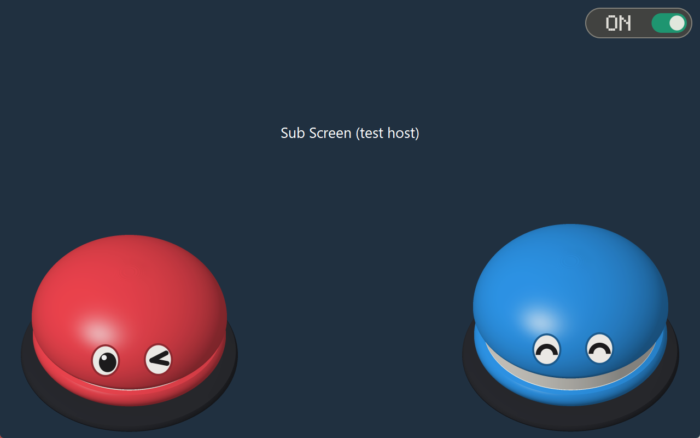

# popn_deka_touch

A [Spice2x](https://spice2x.github.io/) `-k` plugin that puts the two large Pop-Kun buttons (Red and Blue) on the touch sub screen, so you can press them without the physical buttons.



The plugin draws a transparent layer over the game's `Sub Screen` window. Touching the left or right button area sends `Red Pop-Kun` or `Blue Pop-Kun` to Spice2x. Everything outside those areas still reaches the game's own sub screen UI, and a switch in the corner turns the layer off when you need the whole screen.

## Compatibility

- Developed with `M39-2026041500` on Windows x64, in windowed mode (`-w`).
- The plugin does not hook or patch game code, so it is not tied to one game build. It depends on the Spice2x plugin SDK and on the sub screen window being titled `Sub Screen`.
- Touch input was tested with Windows touch injection and a mouse. It has not been tested on a wide range of touch panels.
- Not tested together with physical Red/Blue Pop-Kun buttons bound in Spice2x.

## Installation

1. Download `popn_deka_touch-v1.0.0.zip` from the GitHub Release.
2. Extract `popn_deka_touch.dll` and `popn_deka_touch.ini` into the game directory, next to `spice64.exe`.
3. Add the plugin to your Spice launch arguments:

   ```text
   -k popn_deka_touch.dll
   ```

4. Start the game. The layer appears once the sub screen window is visible.

If you already use another `-k` plugin, add a separate `-k` argument for this DLL.

## Usage

- Touch (or click) the red button on the left or the blue button on the right. Both can be held at the same time.
- The touch area is larger than the picture and is invisible by default. Set `ShowZone=1` to see it while adjusting.
- Touch the ON/OFF switch in the top right corner, or press `F9`, to turn the layer off. While it is off, only the switch stays on screen and every other touch goes to the game.

## Configuration

Edit `popn_deka_touch.ini` before starting the game.

### `[Touch]`

| Setting | Purpose |
| --- | --- |
| `TargetWindow` | Title of the window the layer attaches to |
| `RedButton` / `BlueButton` | Spice2x button ids (`13` = Red Pop-Kun, `14` = Blue Pop-Kun) |
| `StartEnabled` | `1` = the layer is on when the game starts |
| `ToggleKey` | Windows virtual-key code for the keyboard toggle; `120` is `F9`, `0` disables it |
| `RequireFocus` | `1` = show the layer only while the game is the foreground program |
| `ShowZone` | `1` = draw the touch areas |
| `ViewAngle` | Camera height of the built-in pictures in degrees (`15`–`75`) |
| `OverallAlpha` / `DomeAlpha` / `OffToggleAlpha` | Opacity of everything, of the buttons, and of the switch while off (`0`–`255`) |
| `RedColor` / `BlueColor` | Colors of the built-in pictures, six-digit `RRGGBB` |
| `ZoneWidthPercent` / `ZoneHeightPercent` | Touch area per side, used only when `TouchRect` and `Rect` are empty |
| `DomeSizePercent` / `DomeMarginPercent` / `DomeBottomPercent` | Button size and position, used only when `Rect` is empty |
| `ToggleScalePercent` | Switch size, used only when `[Toggle] Rect` is empty |

### `[Red]`, `[Blue]`, `[Toggle]`

Positions are `x,y,width,height` in pixels of a 1280x800 sub screen, with `0,0` at the top left. They scale with the window if it has a different size.

| Setting | Purpose |
| --- | --- |
| `Image` | Picture when not pressed. Empty = built-in picture |
| `PressedImage` | Picture while pressed. Empty = the same picture, slightly brighter |
| `Rect` | Where the picture goes. A custom image is stretched to fill it exactly |
| `TouchRect` | Area that counts as a press. Empty = same as `Rect` |
| `OnImage` / `OffImage` | (`[Toggle]`) Pictures for the switch. Empty = built-in switch |

Image files can be PNG (with transparency), JPG, or BMP. Relative paths start at the folder that contains `popn_deka_touch.dll`:

```ini
[Red]
Image=deka\red.png
PressedImage=deka\red_down.png
Rect=100,80,300,150
TouchRect=60,40,400,260
```

If an image cannot be loaded, the built-in picture is used and a warning is written to the Spice log.

The shipped ini has the built-in positions written out in `Rect` and `TouchRect`. For the built-in pictures only the width and the bottom edge of `Rect` are used.

## Building

Requirements:

- Windows
- Visual Studio 2022 Build Tools with the x64 C++ toolchain
- PowerShell 5.1 or newer

Run:

```powershell
.\build.ps1
```

This produces `build\Release\popn_deka_touch.dll` using the static MSVC runtime. There are no third-party dependencies.

To create the same ZIP and checksum files used by a release:

```powershell
.\package.ps1
```

## Technical notes

- The layer is a separate click-through window placed over the sub screen; it does not touch the game's Direct3D rendering. It follows the sub screen window when that window moves.
- Button presses are sent through the Spice2x plugin SDK (`set_button`) before the picture is redrawn.
- Only the changed button is redrawn on a press, on the plugin's own thread.
- Where the layer is fully transparent, touches fall through to the game. Touch areas are painted with a nearly invisible alpha so they still receive input.
- A touch screen adds its own delay compared with physical buttons.

## License

Project code is released under the [MIT License](LICENSE).
